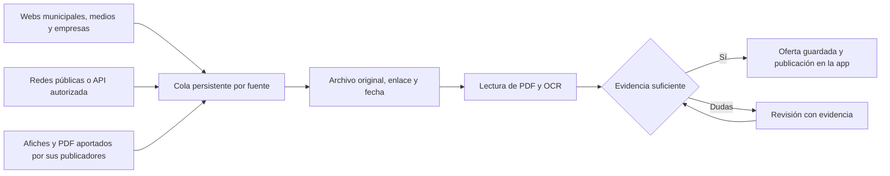

# Decisión propuesta sobre la arquitectura del radar

Propuesta del 14 de octubre de 2026. No aplica una migración, no integra `main`, no modifica credenciales ni contrata servicios. Parte de los resultados comprobados en [avisos recientes y horario](avisos-recientes-y-horario-2026-10-13.md).

## Recomendación

Conservar Trabajo Cerca y reconstruir gradualmente el motor de captación de fuentes difíciles, separado de la interfaz y del escritor de ofertas. No abandonar el proyecto ni reescribir toda la app antes de probar el acceso a sus fuentes principales. Una arquitectura nueva mejora ejecución, trazabilidad y recuperación; por sí sola no obtiene permisos de Facebook/Instagram ni publicaciones que el origen no entrega.

La publicación ya tiene una prueba real: dos ofertas BNE incorporadas tras una búsqueda llegaron al feed con IDs persistidos y sin duplicar el aviso anterior de Negrete. Esto permite conservar interfaz, histórico y contrato de publicación. Las 248 pruebas corresponden a la reparación existente: no acreditan la arquitectura propuesta ni la captación social completa.

La brecha principal es obtener periódicamente publicaciones laborales individuales, su fecha original y todos sus archivos, y convertirlas en evidencia verificable. Los perfiles municipales leídos no prueban identidad de una OMIL dedicada. El lector oficial actual relee fuentes curadas; no descubre por sí mismo todas las ofertas nuevas.

## Diseño propuesto

1. **Registro de fuentes y conectores específicos.** Para cada OMIL, radio, medio o empresa: identidad, canal exacto, acceso permitido, última lectura y cobertura realmente observada. Las páginas públicas usan HTML o navegador según corresponda; los accesos autenticados necesitan la vía que autorice el publicador y permita la plataforma. Una fuente que falla no impide procesar las demás.
2. **Captura independiente y persistente.** Separar descubrimiento, descarga, extracción y verificación en trabajos recuperables. Cada uno conserva cursor, intentos y resultado. Guardar el documento original, hash, ID/enlace de la publicación y la prueba de su fecha. Recorrer historia hasta 45 días solo cuando la fuente lo permita y lo demuestre; no confundir intervalo solicitado con intervalo recuperado.
3. **Procesamiento documental recuperable.** Leer texto del PDF primero y aplicar OCR a las imágenes/páginas necesarias. Procesar documentos largos por partes sin declarar completa la lectura de una sola página. Conservar evidencia por campo; no depender únicamente de etiquetas como «Empresa:». Un afiche con varios cargos necesita separación de ofertas y deduplicación probadas, sin tratar veinte plazas del mismo puesto como veinte avisos.
4. **Verificación y revisión.** Comprobar cargo, empleador, lugar real, contacto, fecha original y vigencia. Correo o teléfono no prueban por sí solos que una vacante siga abierta. Para avisos sin cierre, usar una prueba de postulación abierta o confirmación documentada de la fuente, sin inventar una fecha. Los datos inciertos requieren revisión; no se publican automáticamente como verificados.
5. **Publicación desacoplada.** Reutilizar inicialmente el contrato de ofertas y el puente firmado existentes. Comprobar el ID persistido y su presencia en el feed, repetir sin duplicados y conservar el histórico. El procesamiento de archivos no se realiza dentro de una petición de la interfaz.

Un motor Python con navegador automatizado y Poppler/Tesseract es una opción compatible con lo ya construido. Para un piloto con un solo ejecutor puede usarse SQLite y archivos persistentes. Si la operación requiere varios procesos concurrentes, se puede evaluar PostgreSQL y almacenamiento de archivos independiente. Son alternativas de diseño, no servicios instalados ni credenciales solicitadas.

## Acceso a redes y relación con las fuentes

La captura por navegador puede servir para contenido público que se entregue efectivamente. Las pruebas encontraron enlaces de Facebook en Renaico y Negrete, pero el acceso de Negrete no fue estable entre lecturas y no se verificó un aviso laboral elegible. No se propone depender exclusivamente de este mecanismo.

La [documentación de Instagram publicada por Meta en Postman](https://www.postman.com/meta/instagram/documentation/6yqw8pt/instagram-api) describe acceso para cuentas profesionales y permisos; su modalidad con Facebook Login excluye cuentas personales. Una API no concede automáticamente acceso a cualquier perfil ni a todo su histórico. Cada integración debe comprobar el alcance de sus permisos antes de presupuestar o construir su conector.

La segunda entrada necesaria es una vía sencilla para que OMIL, radios y empresas aporten el afiche/PDF y su origen. La propuesta conserva el descubrimiento automático donde funciona y añade suministro directo de los publicadores. Esto reduce la dependencia de publicaciones inaccesibles, pero exige colaboración que todavía no está acordada. No se contactó a esas entidades durante esta evaluación.

## Piloto de viabilidad antes de una reconstrucción grande

Comenzar en dos comunas y con fuentes específicas identificadas. Preparar un conjunto independiente de avisos reales de los últimos 45 días; una referencia pequeña de 10–20 avisos es un objetivo de evaluación, sujeto a que existan y puedan obtenerse. Incluir una OMIL, un medio y una empresa local, y probar al menos un afiche o PDF laboral por una vía permitida. Los avisos cerrados forman parte del archivo de evaluación, pero no se cuentan como publicaciones vigentes.

Condiciones propuestas de aceptación:

- Recuperar automáticamente avisos de las fuentes accesibles, con enlace o aporte original, fecha acreditada y archivos completos.
- Medir recuperación frente a la muestra independiente, no frente a los candidatos que el propio recolector decidió ver. Un objetivo inicial de 80 % de recuperación en esa muestra accesible debe acordarse y comprobarse; no es un resultado actual ni una promesa para todas las redes.
- Demostrar una oferta real de cada vía difícil hasta el ID visible en la app, manteniendo revisión para los campos inciertos.
- Repetir lecturas durante siete días, conservar los cursores e IDs y simular fallos sin perder registros ni duplicar ofertas.
- Identificar explícitamente las fuentes no accesibles y el trabajo humano necesario; no atribuirles cobertura de 45 días.

Los siete días son una ventana propuesta de observación después de que el piloto funcione, no una fecha de entrega garantizada. No hace falta contratar IA para probar lectura documental. La operación continua necesita un ejecutor disponible, almacenamiento y mantenimiento; su costo debe evaluarse según infraestructura disponible. No se promete costo cero permanente ni se autoriza gasto con este documento.

## Decisión posterior al piloto

Si el piloto acredita captura, extracción y publicación reales con una carga de revisión aceptable, reemplazar progresivamente el radar y conservar la app. Si el motor actual no puede integrarse de forma mantenible, evaluar después una app nueva que use el motor ya validado e importe el histórico.

Si las fuentes esenciales no pueden leerse de forma permitida y sus publicadores no aportan los avisos, una reescritura completa no corrige la falta de datos. En ese caso conviene limitar la cobertura a fuentes comprobadas o pausar el objetivo de cobertura social exhaustiva antes de invertir más.

Rehacer la app desde cero es técnicamente posible. Su viabilidad depende primero de comprobar la captación de los avisos difíciles, no de elegir otro framework o proveedor de alojamiento.
