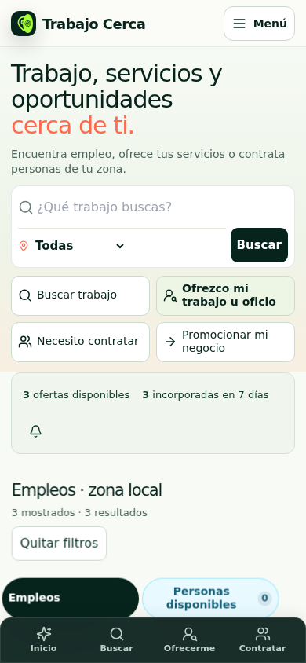
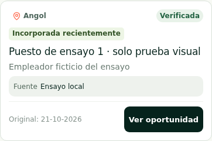

# Trabajo Cerca — interfaz compacta y radar territorial

**Validación:** 22 de octubre de 2026. **Cierre documental:** 23 de octubre de 2026 (UTC). **Estado:** candidata actualizada y probada; PR #2 en borrador, sin fusión ni despliegue. **No lista para lanzamiento público general por los cuatro bloqueantes previos del apartado 13.**

## 1. Base y archivos modificados

Se partió de la cabeza comprobada del PR #2, `3d4267fce57470fa4c899992002c5654bea2f932`, y se cotejaron 98 archivos locales con sus hashes Git antes de copiar la base de trabajo. No se usó una versión antigua de AppDeploy para sustituirlos. Código final probado: **`35c41f422cd179fce6fce10e4e99849a077f5b46`**, en `repair/mulchen-captura-2026-10-17`.

- `integrations/appdeploy/house-ads/src/App.tsx`
- `integrations/appdeploy/house-ads/src/activity-center.tsx`
- `integrations/appdeploy/house-ads/src/compact-layout.css`
- `integrations/appdeploy/house-ads/src/compact-presentation.ts`
- `integrations/appdeploy/house-ads/src/feed-presentation.ts`
- `integrations/appdeploy/house-ads/src/reading-history.ts`
- `integrations/appdeploy/house-ads/src/site-menu.tsx`
- `integrations/appdeploy/house-ads/src/territorial-radar.tsx`
- `integrations/appdeploy/house-ads/src/territorial-sections.tsx`
- `integrations/appdeploy/house-ads/backend/index.ts`
- `integrations/appdeploy/house-ads/qa/prepare-before.mjs`
- `integrations/appdeploy/house-ads/qa/rc-browser-check.mjs`
- `integrations/appdeploy/house-ads/qa/run-check.mjs`
- `integrations/appdeploy/house-ads/qa/sdk-browser-stub.ts`
- `integrations/appdeploy/house-ads/qa/sdk-contract.d.ts`
- `integrations/appdeploy/house-ads/qa/territorial-ui-check.mjs`
- `integrations/appdeploy/house-ads/tests/territorial-ui.test.mjs`
- `integrations/appdeploy/house-ads/index.html`
- `.github/workflows/radar.yml`
- `tests/territorial-ui.test.mjs`
- `integrations/appdeploy/house-ads/tests/tests.json`

Se reutilizan `App`, formularios, panel de detalle, `HouseBanner`, inventario, SDK y componentes territoriales. `vnext.css` y el motor HOUSE_AD se conservaron; las medidas públicas se consolidan en `compact-layout.css`. No se creó otra portada ni se añadieron dependencias. Las promociones, el backend comercial, el archivo de seis crons, la política de seguridad, el lockfile, el Vite de producción y los recursos PWA coinciden con la base; sus hashes están en `unchanged.json`.

## 2. Interfaz realmente aplicada

- Cabecera móvil de 60 px, marca y menú separados; cuatro acciones de publicación/búsqueda compactas y accesibles.
- Mensaje solicitado: **Trabajo, servicios y oportunidades cerca de ti.** Buscador con cargo, localidad y Buscar; botones móviles sin altura de dos filas.
- Franja de actividad compacta: total local y altas en siete días son accesos directos; la campana abre el centro de novedades.
- Diez resultados por página, navegación anterior/siguiente y total del conjunto. Las pestañas permiten acceder a personas, necesidades y servicios; no se mezclan necesidades particulares con el contador de ofertas laborales.
- Radar compacto después de resultados; ciudades complementarias, actualidad y trámites en secciones desplegables accesibles también desde el menú. Los diagnósticos de motores/OCR ya no aparecen en el DOM público. Las vistas administrativas existentes se conservaron.

## 3. Comparación visual antes/después

Mismo navegador, viewport y tres avisos de ensayo para ambos renders; base anterior del **PR**, no captura de una versión desplegada. Son pruebas aisladas con adaptador SDK y datos claramente sintéticos. Las fuentes/fotografías remotas referenciales se bloquean deliberadamente en ambos lados. Las alturas son geometría de ese render, no métricas de tráfico ni de todas las ofertas reales.

| Ancho | Altura de página, px | Reducción | Primera tarjeta, px | Franja, px |
|---|---|---|---|---|
| 320 | 6629 → 3012 | 54.6% | 519 → 261 | 104 |
| 360 | 6386 → 2951 | 53.8% | 519 → 261 | 104 |
| 390 | 6215 → 2854 | 54.1% | 519 → 239 | 104 |
| 430 | 5996 → 2800 | 53.3% | 439 → 240 | 58 |
| 768 | 4824 → 2544 | 47.3% | 296 → 240 | 58 |
| 1024 | 4576 → 1982 | 56.7% | 297 → 244 | 62 |
| 1440 | 3793 → 1995 | 47.4% | 297 → 244 | 62 |

Primera pantalla a 390 px:

| Antes | Después |
|---|---|
|  |  |

Capturas comparables de [actividad antes](evidence/ui-2026-10-22/ui-before-390-activity.png)/[después](evidence/ui-2026-10-22/ui-after-390-activity.png), [radar antes](evidence/ui-2026-10-22/ui-before-390-radar.png)/[después](evidence/ui-2026-10-22/ui-after-390-radar.png), [HOUSE_AD antes](evidence/ui-2026-10-22/ui-before-390-house.png)/[después](evidence/ui-2026-10-22/ui-after-390-house.png), [resultados filtrados](evidence/ui-2026-10-22/ui-after-390-filtered.png) y [escritorio antes](evidence/ui-2026-10-22/ui-before-1440-top.png)/[después](evidence/ui-2026-10-22/ui-after-1440-top.png). El expediente descargable conserva las capturas completas y las siete anchuras.

## 4. Tarjeta laboral compacta

Se retiró `NeoArtwork` de las tarjetas y del detalle público: no se sustituyen afiches por fotografías genéricas. Una tarjeta contiene cargo, empleador cuando no es un nombre genérico de portal, localidad real, fuente, fechas, remuneración existente y estado; se eliminó la fila vacía Zona. Metadatos legibles y botón Ver oportunidad, sin cabecera fotográfica.

La imagen original se muestra como miniatura cuando llega en un campo público explícito `originalPosterUrl`/`sourceImageUrl` y pertenece a un origen HTTPS permitido. Abre el detalle y el afiche completo. No se publican rutas privadas de evidencia ni se inventan URLs. Este recorrido está probado con una imagen de ensayo; no acredita que todos los afiches históricos dispongan ya de URL pública. El detalle conserva descripción, postulación, evidencia, enlace de fuente y contacto protegido. Usa el mismo estado Por revalidar que la tarjeta, además de foco de teclado y cierre con Escape.

## 5. Contadores y navegación

El cliente recupera páginas del inventario público existente, deduplica por ID y declara la consulta incompleta hasta terminar. Después calcula el conjunto territorial y temporal sobre los registros recuperados, evitando sumar comunas que pueden compartir avisos. Todas mantiene el criterio local anterior; las ciudades complementarias siguen siendo una elección explícita. El radar conserva acceso a las trece localidades, incluida Victoria.

Los números y listas usan el mismo conjunto; las lecturas no alteran el total. Un filtro muestra su sección/localidad en el título, admite Quitar filtros, enfoca `neo-jobs` y realiza un único desplazamiento. Se corrigieron accesos al ID inexistente `radar`, el doble scroll y el reinicio de página al actualizar. Si se alcanza el límite defensivo de 100 páginas automáticas o falla una lectura, no se presenta el conjunto parcial como completo; queda carga manual/reintento disponible.

## 6. Novedades y lectura

**Prueba aislada:** 26 ofertas, una persona y una necesidad, en cuatro páginas API. Una oferta incorporada hace nueve días queda fuera; las otras 25, incorporadas hace dos días, aparecen exactamente en tres páginas visuales de diez. Leer una de ellas deja **24 no leídas entre las incorporadas**, sin reducir las 25 incorporaciones. Lumaco muestra exactamente sus 12 resultados. Se probaron los clics, la actualización desde una página avanzada y la recarga.

La ventana usa `firstPublishedAt` y el respaldo histórico `createdAt` que ya usa el inventario; nunca usa la última edición/revalidación. Original e incorporación se muestran separadas cuando esos datos están disponibles. Una fuente originalmente antigua no se anuncia como vacante recién creada.

`tc-reading-v1` guarda únicamente IDs y marcas de tiempo, con retención de 90 días y máximo de 2.000 entradas. No contiene contactos, nombres ni tokens. Soporta datos corruptos y almacenamiento no disponible sin romper el catálogo; si el navegador impide guardar, la persistencia no puede garantizarse. La primera visita no se convierte en un falso cero de novedades ni en historial inventado. No existe sincronización entre dispositivos. No se implementó una etiqueta especulativa nueva para ti.

## 7. Radar por localidad

Las trece localidades están disponibles como botones, sin trece nombres superpuestos en el círculo. Los conteos vienen de `communeStats`; ausencia de datos se etiqueta Sin datos, y cero publicaciones no significa ausencia de empleos. Elegir Lumaco aplica el filtro, abre sus resultados y enfoca el contenedor. La fecha mostrada procede de `updatedAt`, no del giro de la animación.

El barrido CSS es decorativo: no importa el SDK ni ejecuta búsquedas. Se comprobó la pausa fuera de pantalla y `prefers-reduced-motion`; la pausa al ocultar la pestaña usa `visibilitychange`. No se declara actividad de rastreo en vivo ni se generaron ofertas desde el radar. No es un mapa geográfico de coordenadas.

## 8. Estado real de push

**Centro de novedades operativo sin push:** consulta, localidad, filtro de incorporaciones/no leídas y actualización del catálogo. No pide permisos ni suscribe dispositivos.

**Push: en preparación, activación deshabilitada.** La referencia oficial SDK 2.11.0 confirma suscripción, desuscripción y emisor administrado; no se almacenan tokens FCM en la aplicación. Sin embargo, `notificationSweepHandler` no está en ninguno de los seis crons. El emisor heredado tiene consultas limitadas a 200, selección basada en verificación y carece de recibos durables por destinatario/ID; necesita revisión antes de habilitarlo para evitar duplicados, pérdidas y avisos por revalidación.

Falta una prueba autenticada con dispositivo compatible: permisos, persistencia, entrega visible con app cerrada/en segundo plano, error y desuscripción; también comprobar cuota/costo de plataforma y el mecanismo de disparo autorizado. No se invocó `notifications.send`, no se añadió un cron ni se simularon entregas como reales. Push no bloquea el lanzamiento por sí solo porque se anuncia honestamente en preparación.

## 9. Instalación PWA

Se mantienen manifiesto e íconos reparados. Chromium no detectó impedimentos de instalación; service worker listo, API privada fuera de caché y recursos/SEO estáticos correctos en el ensayo. El botón da instrucciones cuando no hay prompt y maneja errores sin afirmar instalación.

Se conservan eventos diferentes para disponibilidad del prompt, aceptación, descarte y `appinstalled`. Un clic o una aceptación no se cuenta como instalación terminada. La clasificación se ensaya con eventos del navegador; **no se hizo instalación física Android/iOS**. La ruta general de analítica externa continúa deshabilitada por la política existente: emitir callbacks no demuestra que PostHog esté registrándolos.

## 10. HOUSE_AD y marketing

Se mantienen seis campañas, sus rutas y las condiciones centralizadas: **20 fundadores elegibles, 30 días individuales, prueba posterior de 14 días y cero cobros automáticos**. El banner no activa pruebas ni promete una fecha de lanzamiento inventada. Los anuncios comerciales externos conservan el espacio de búsqueda anterior; las campañas propias se integran después de los primeros resultados. Sin anunciantes no quedan huecos injustificados ni se crean negocios ficticios.

La comprobación a 320 px recorrió las seis campañas: ¿Tienes un oficio o profesión?: 136 px; Tu negocio, más cerca de tus clientes.: 198 px; ¿Necesitas alguien para trabajar?: 136 px; Aquí hay espacio para todos.: 136 px; Trabajo Cerca nace para nuestras comunas.: 154 px; ¿Ofreces alojamiento, alimentación o servicios para empresas?: 198 px. Sus textos no se recortan; con textos ampliados o creatividades futuras más largas la altura puede crecer para preservar legibilidad.

Se conservan impresión visible, clic y embudo internos existentes y sus recibos de deduplicación; las suites verifican formularios y separación HOUSE/comercial. No se activó PostHog ni se agregaron métricas financieras simuladas. Clic no equivale a contratación. Las métricas reales de la candidata requieren desplegarla y probar el SDK aislado; las pruebas actuales usan adaptador.

## 11. Pruebas aprobadas y fallos corregidos

**351 Node y 243 Python aprobadas** en la candidata. Build frontend, TypeScript de todo el frontend con contratos del SDK, módulos comerciales y empaquetado completo del backend aprobados. No se cambió el lockfile y no se repitió capacidad de 5.000 anuncios. Auditoría runtime npm: cero vulnerabilidades reportadas en ese momento, sin garantía futura.

Playwright cubre 320, 360, 390, 430, 768, 1024 y 1440 px: alturas, legibilidad de pestañas, ausencia de desbordamiento, formularios, pie no tapado, clics, filtros, paginación, lectura, afiche, radar, movimiento reducido, privacidad, PWA, administración y publicidad. Texto ampliado realmente al 125 % en 360 px sin cortes de controles esenciales. Cero errores JavaScript/infracciones CSP inesperados y cero errores de red inesperados en el entorno aislado; fuentes/fotos remotas bloqueadas deliberadamente no se cuentan como fallo de producto.

Fallos intermedios documentados y corregidos: extracción de la base desde un directorio Git incorrecto; discrepancia de texto por mayúsculas CSS; franja estirada por reglas heredadas; un anuncio de 297 px en dos columnas y una creatividad que todavía alcanzaba 223,5/219,9 px tras los primeros ajustes. No se dieron por aprobados esos intentos. El último run prueba todas las seis campañas dentro del objetivo de altura.

| Criterios solicitados | Evidencia |
|---|---|
| 1–9, diseño | Comparación antes/después, siete anchos, tarjetas sin fotos genéricas, afiche, campos, pestañas, navegación y pie. |
| 10–17, novedades | Fechas de nueve/dos días, fecha inicial estable, lectura persistente, 25 incorporaciones paginadas, clics y filtro territorial. |
| 18–23, radar | Trece localidades, datos/estado explícitos, filtro real, código sin recolector, pausa fuera de pantalla y movimiento reducido. |
| 24–28, novedades/PWA | Centro sin push, push deshabilitado, recursos instalables y clasificación separada de eventos; sin afirmación de instalación física. |
| 29–35, negocio y regresión | HOUSE/formularios/promociones/seguridad, detalle íntegro, cero pagos, hashes de seis handlers/crons y pruebas de administración. |

## 12. Riesgos y límites

Los formularios, autenticación administrativa de la candidata y almacenamiento mutante se prueban con adaptador/fixtures. **Eso no es una integración SDK real de escritura.** El ensayo de recuperación sigue siendo SQLite cifrado representativo, no AppDeploy completo. Las observaciones SDK públicas corresponden a la app anterior desplegada.

El conteo exacto requiere recuperar el inventario público: actualmente es pequeño, pero hasta 100 páginas automáticas elevan lecturas y memoria al crecer. Se renderizan solo diez filas por página; eso no prueba concurrencia distribuida ni costo ilimitado. El historial local puede perderse al borrar datos del navegador. Orígenes de afiches tienen lista de permisos: no se exponen imágenes privadas por adivinar una URL.

## 13. Pendientes reales para producción

Siguen abiertos los cuatro cierres previos: **cabeceras HTTP del documento en el alojamiento, protección de main, identificación legal del responsable y restauración/recorridos autenticados en una instancia SDK aislada**. No se inventaron datos legales ni se solicitó una contraseña de respaldo. No se migró a Cloudflare u otra plataforma.

La calidad editorial sigue siendo un asunto distinto del rediseño. La observación real más reciente está en `live-baseline.json`: conserva los tres IDs de Traiguén, distingue registro publicado de verificación fresca y no cuenta esas filas como nuevas publicaciones. Los pendientes de revalidación se señalan; no se borraron históricos ni se cambió el pipeline para inflar resultados. **Publicaciones nuevas realizadas por esta tarea: cero.**

Antes de lanzar: cerrar esas puertas, revisar el catálogo que se anuncie como verificado, comprobar la cabeza exacta del PR y obtener autorización de integración/despliegue. Push recurrente, analítica avanzada y automatizaciones adicionales quedan condicionadas para después; no se abrieron esos frentes.

## 14. Commit, PR y expediente

Código probado: `35c41f422cd179fce6fce10e4e99849a077f5b46`. [PR #2](https://github.com/mrvvergara-afk/Trabajo-Cerca-/pull/2), **borrador, no fusionado**. [Run final 39873900842](https://github.com/mrvvergara-afk/Trabajo-Cerca-/actions/runs/39873900842) y verificación de PR aprobados sobre el código indicado. main permanece en `fab392b824e4100a4bba6dfe9289825297d24707`. No se ejecutó ninguna herramienta de despliegue.

Artefacto 12467830602, SHA-256 `86b05e67bd0dba6ee949a347434cb8df7f86d94ad11292dd7f0181980e419245`, descargado y verificado. JSON, hashes y capturas seleccionadas se conservan en Git; el expediente completo incluye las capturas de las siete anchuras. La reversión de código y las cautelas para no revertir datos/cupos siguen en el informe de cierre técnico anterior. El commit documental final actualiza el informe y las instrucciones de QA manual a esta interfaz, sin cambiar el código funcional probado.
